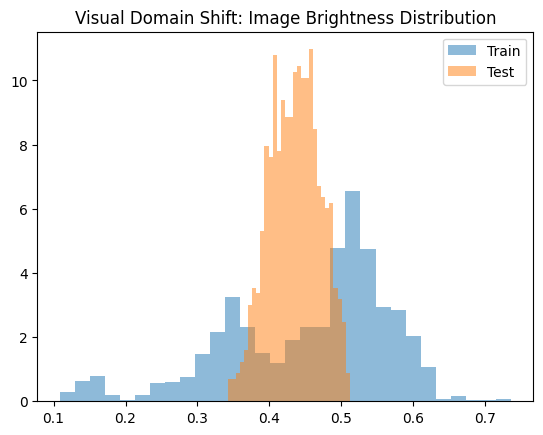
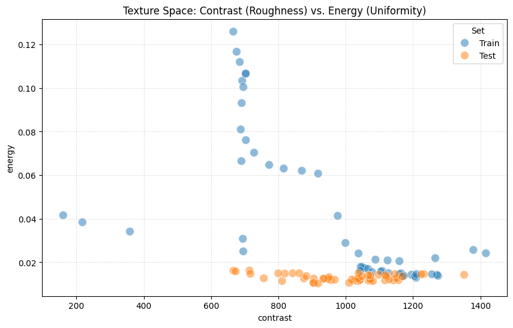
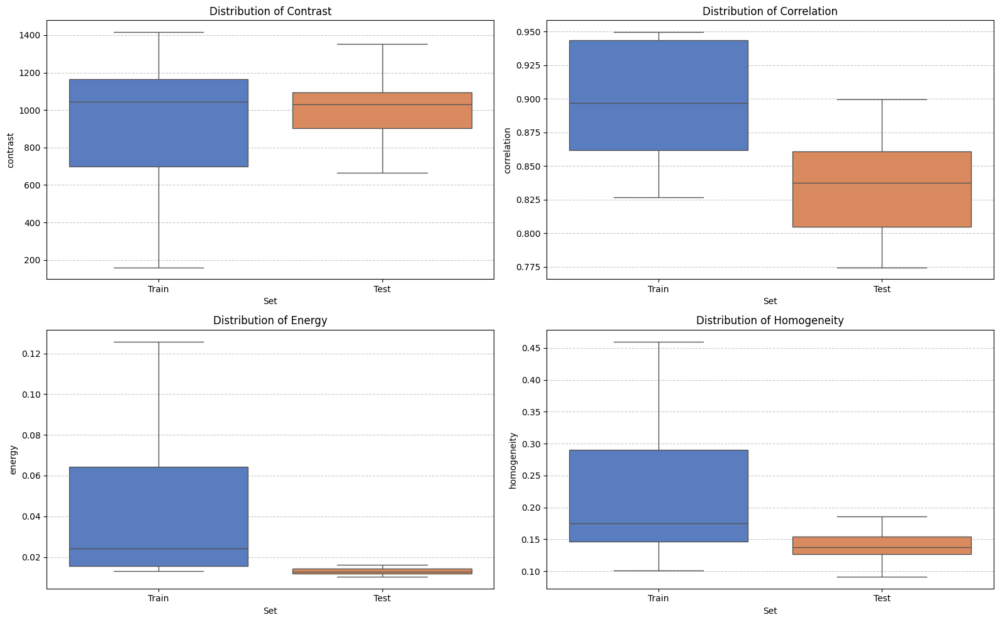

### Challenges:
    1) Background clutter: Objects might be set against backgrounds with confusing patterns or multiple overlapping objects 
        a) Things camoflague very easily in desert.
    2) Intra-class variability: Objects within the same class can vary significantly in appearance. 
        a) Lush Bushes (200), Dry Grass (300), Dry Brushes (500) 

    3)  Images can be in different mode:
        a) Weather: Clear, Fog, Rain
        b) Cloud Condition: Light, 
        c) Time Of the Day : Continuous

    4) Dataset is not random instance of a camera, its actually consecutive frames of a video
        - Important Decision To Make:
            randomly sample the data during training for better generalization but that sequential relation is broken... OR sample the Data in existing flow so that the model caputres the sequential relation better

        - CHOICE MADE: EZ:
            out context doesnt require us to use consecutive frames.
            if we do use sequential sampling , lets say 4 images are present in a batch, all of them will look approximately same so teh modelw will be highly biased and overfit

    5) Spread:
        a) Train: 2800 images
        b) Val: 300 images
        c) Test: 1000 images
        d) Dimension: 960*540
        e) Pixel Count: 960

--------------------------------------------------------------------------------------------------------------------------------------------
### hellooooo

# MUST HAVE FOLDER STRUCTURE

root->data->Offroad_Segmentation_testImages
          ->Offroad_Segmentation_Training_Dataset

the above 2 folder are the resulting folders of extracting teh zip dataset from teh website 

# LOGS

## APPROACH 1: Vanilla U-NET

- Nothing, crazy yet  
- No augmentation  
- No special operation  
- Just training a vanilla U-Net from scratch  
- Files live in `root/v1_vanilla_unet`

---

---

## V1 – Vanilla U-Net

- The image resolution was kept to **512 × 512**
- Epochs = **20**
- Train_mean_iou = **0.4697**
- Val_mean_iou = **0.4247**
- test_mean_iou = **0.259047**

### Observation
- The image resolution was dropped significantly, making the image grainy
- The model is reling very heavily on teh textures and not on the edges
- Overfitting

## Approach 2 : Data Augmentation and Using a pretrained model as a backbone

### Data Augmentation
- horizontal flip
- brightness
- contrast
- saturation

### Pretrained Model: ResNeet50
- WHY?
1) u net is neuural network with many layers -> Vanishing gradient........ResNet uses skip connection inside the encoder only
2) instead of two **3*3** convolution it uses two **1*1** (reduce the channel and recover the channel) and a **3*3** to for spatial feature

## Version 1:
- image resolution: **512*512**
- Epochs= **20**
- Train_mean_iou=**0.6328**
- val_mean_iou=**0.25**

### observation 
- domain shift between train and test.
- class imbalance is large
- proper eda required and then steps needed to fix the class imbalance
- mean_iou is not a great metric
- WE ARE DISTORTING THE IMAGE TOO MUCH BY FORCING IT TO **512*512**

- HUGE CLASS IMBALANCE FOUND

| Label           | Train %    | Val %      | Test %     |
|-----------------|------------|------------|------------|
| Trees           | 3.529683   | 4.063176   | 0.269498   |
| Lush Bushes     | 5.933981   | 6.014540   | 0.001479   |
| Dry Grass       | 18.872895  | 19.344905  | 17.373509  |
| Dry Bushes      | 1.099030   | 1.099044   | 3.045014   |
| Ground Clutter  | 4.394827   | 4.239041   | 0.000000   |
| Flower          | 2.807256   | 2.435103   | 0.000000   |
| Logs            | 0.078129   | 0.066852   | 0.000000   |
| Rocks           | 1.198249   | 1.213580   | 18.131278  |
| Landscape       | 24.447772  | 23.767870  | 43.184236  |
| Sky             | 37.638177  | 37.755889  | 17.994986  |

- Domain shift

- the trainsing dataset brigthness has more variance (spread out) while the test images stays around the same
- AI Review : The Test Set (Orange): It is very "tight" and consistent. Most of your test images fall into a narrow brightness range between 0.35 and 0.5. This suggests your test data was likely collected under similar lighting conditions (e.g., all at the same time of day or with the same camera settings).

The Train Set (Blue): It is much more "spread out" (higher variance). It covers a wide range from 0.1 to 0.7.

The Interpretation: Your training data is more diverse, which is usually good, but it contains many "extremes" (very dark and very bright images) that the test set never sees.
---

Your training data is "noisy" and "chaotic" (high variance in texture). Your test data is incredibly uniform and low-energy. This means the "ground" or "background" in your test images is much smoother and more predictable than what you're showing the model during training.

---

The Boxplot Analysis (Metric Breakdown)
Energy & Homogeneity: In both plots, the Test set (orange) has significantly lower variance and lower absolute values than the Train set.

Correlation: The Test set is shifted much lower than the Train set. This means pixels in your Test set are less "predictable" based on their neighbors compared to Train.

The Verdict: Your Train set contains many "easy," repetitive textures that don't exist in the Test set. The model might become "lazy" by over-learning these easy textures, then get confused when it sees the unique texture profile of the test biome.

## measuing average sizes per classes
- Train

| Class | mean | median | std | max | count |
|-------|------|--------|-----|-----|-------|
| Ground Clutter | 8.593220 | 2.0 | 44.446098 | 3813.0 | 426080 |
| Dry Bushes | 21.961125 | 1.0 | 362.576538 | 27280.0 | 208744 |
| Rocks | 24.267058 | 2.0 | 231.315109 | 10597.0 | 70247 |
| Landscape | 27.817899 | 1.0 | 1645.422149 | 205887.0 | 1089631 |
| Lush Bushes | 30.394144 | 1.0 | 136.336877 | 3976.0 | 7104 |
| Dry Grass | 63.697840 | 1.0 | 2072.899087 | 186825.0 | 490704 |
| Sky | 14010.154176 | 1.0 | 54564.816557 | 416541.0 | 2335 |

---
- Test

| Class | mean | median | std | max | count |
|-------|------|--------|-----|-----|-------|
| Lush Bushes | 6.857627 | 2.0 | 21.386096 | 219.0 | 590 |
| Trees | 15.752852 | 2.0 | 88.224420 | 3542.0 | 10605 |
| Dry Grass | 16.434944 | 1.0 | 649.498716 | 100755.0 | 1114638 |
| Rocks | 27.019026 | 2.0 | 431.118937 | 117716.0 | 695829 |
| Dry Bushes | 33.096755 | 1.0 | 848.693653 | 97580.0 | 123714 |
| Landscape | 56.876574 | 2.0 | 2787.642924 | 266790.0 | 740308 |
| Sky | 2766.540594 | 1.0 | 17094.046516 | 156717.0 | 7575 |

- The Interpretation: Your test objects are significantly smaller than your training objects. A model trained on the larger "Lush Bushes" will likely overlook the tiny 6-pixel versions in the test set.

### [STEP 1] Direct answer:
- Absent classes in test → IoU undefined → treated as 0.
- Mean IoU penalized even if model makes no mistake.
- Example: Ground Clutter, Flower, Logs → 0 GT pixels → IoU = 0 → mean IoU drops ~30%.

### [STEP 2] Immutable constraints:
- Cannot remove/merge/ignore absent classes.
- Leaderboard evaluation uses external script.
- Dataset-level mean IoU must remain harsh.

### [STEP 3] Recommended dual metric system:
- A. Leaderboard-faithful (harsh):
  * Dataset mean IoU (all classes)
  * Dataset per-class IoU
  * Dataset worst-class IoU
- B. Diagnostic (fair):
  * Batch mean IoU (skip absent classes)
  * Batch per-class IoU (only if present)

### [STEP 4] Interpretation:
- Dataset-level IoU → "How will judges score me?"
- Batch-level skip-absent IoU → "When class appears, can model handle it?"

### [STEP 5] Final metric design:
- Dataset-level (stateful, harsh): mean IoU, per-class IoU, worst-class IoU.
- Batch-level (stateless, fair): mean IoU skipping absent, per-class IoU if present.

### [STEP 6] Implementation notes:
- Must accumulate TP/FP/FN across batches.
- Compute IoU at epoch end via tf.keras.metrics.Metric.
- Avoid per-image penalties and batch noise.

### [STEP 7] Explicit concern addressed:
- Absent classes → IoU = 0 even with perfect predictions.
- Strategic implication: optimize IoU for present classes, avoid hallucinating absent ones.

### [STEP 8] Next implementation plan:
- DatasetMeanIoU (stateful)
- Batch-wise skip-absent IoU functions
- Integration with model.compile
- Logging via TensorBoard/console

### [STEP 9] Conceptual takeaway:
- Segmentation benchmarks sometimes measure dataset pathology, not model quality.
- Strong solutions accept this, design parallel metrics, and still optimize for official score.

## 1 mistake in preprocessing pipeline. 
- if the dataset was training i was passing performaugmentation=True and this was resulting in my dataloadeed to perform resnet50.preprocessing and then augmenting which was essentially clipping the input below 1.0 which was destroying it.
- thats why there is such a huge difference between train and val iou score even if the dataset is similar
- training dataset was being clipped to below 1 destroying but the validation dataset had performaugment=false. which didnt mess up with the data after resnet50.preprocessing 

- For TensorFlow ResNet50, preprocess_input does:
  - Convert RGB → BGR
  - Subtract ImageNet mean:
    - 103.939
    - 116.779
    - 123.68
  - DOES NOT divide by 255

- So the  model expects:
  - float32
  - range roughly [-120, +150]
  - NOT 0–1
  - NOT raw 0–255

    
    
